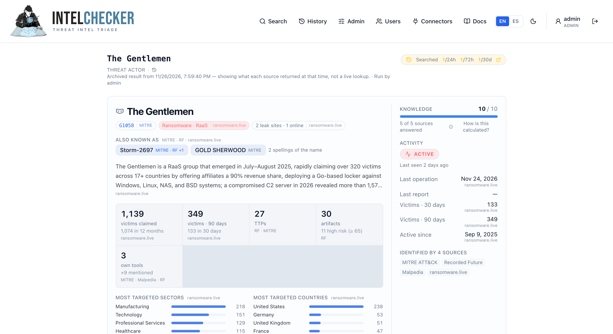

<div align="center">

# 🛡️ IntelChecker

**Real-time Threat Intelligence triage for SOC analysts and CTI teams**

*Submit an indicator — get consolidated results from multiple sources in seconds.*

[](https://www.python.org/)
[](https://fastapi.tiangolo.com/)
[](https://react.dev/)
[](https://www.typescriptlang.org/)
[](https://tailwindcss.com/)
[](https://vitejs.dev/)

</div>

---

## ✨ Features

| | |
|---|---|
| ⚡ **Parallel queries** | All CTI sources are queried simultaneously — no waiting in line |
| 🎴 **Per-engine cards** | Each source renders its result independently as soon as it responds |
| 📊 **Summary section** | GeoIP and ASN aggregated across all engines with consensus count |
| 🎯 **Threat score gauge** | Visual semicircle gauge (0 – 10) driven by the VerdictEngine |
| 🔍 **Raw JSON viewer** | Per-card `{ RAW }` button opens a syntax-highlighted modal with copy & download |
| 🛠️ **Actionable errors** | Failed sources show the exact reason (invalid key, rate limit, timeout…) |
| 🌗 **Dark / Light mode** | Full theme support — syntax highlighter adapts automatically |

---

## 🔎 CTI Engine Coverage

| Engine | IP | Domain | URL | Hash | ASN | Threat Actor |
|---|:---:|:---:|:---:|:---:|:---:|:---:|
| [AbuseIPDB](https://www.abuseipdb.com) | ✅ | | | | | |
| [VirusTotal](https://www.virustotal.com) | ✅ | ✅ | ✅ | ✅ | | |
| [ThreatFox · abuse.ch](https://threatfox.abuse.ch) | ✅ | | | ✅ | | |
| [AlienVault OTX](https://otx.alienvault.com) | ✅ | ✅ | ✅ | ✅ | | ✅ |
| [IPinfo](https://ipinfo.io) | ✅ | | | | | |
| [Shodan](https://www.shodan.io) | ✅ | | | | ✅ | |
| [Tor Exit Nodes (dan.me.uk)](https://www.dan.me.uk/tornodes) | ✅ | | | | | |
| [URLhaus · abuse.ch](https://urlhaus.abuse.ch) | ✅ | ✅ | ✅ | ✅ | | |
| [MITRE ATT&CK](https://attack.mitre.org) | | | | | | ✅ |
| [RIPEstat](https://stat.ripe.net) | ✅ | | | | ✅ | |
| [urlscan.io](https://urlscan.io) | | ✅ | ✅ | | | |
| [MalwareBazaar · abuse.ch](https://bazaar.abuse.ch) | | | | ✅ | | |
| [PhishTank](https://phishtank.org) | | | ✅ | | | |

> No API key required for Tor Exit Nodes, MITRE ATT&CK, RIPEstat, or PhishTank — all four are free public datasets/APIs, always on, toggleable like any other source. MITRE ATT&CK caches its ~50 MB STIX dataset in memory for 24h (the first lookup after a cold start takes a few seconds). RIPEstat returns routing (ASN/prefix) and abuse-contact data from the RIPE NCC registry. PhishTank's `checkurl` API works anonymously — an optional `PHISHTANK_API_KEY` gets you higher request priority but isn't required.
> urlscan.io queries the public search index of scans already submitted by others (passive lookup) — it does not submit your indicator for an active scan, so nothing you look up becomes visible to third parties.
> MalwareBazaar shares its credential with ThreatFox and URLhaus (`ABUSECH_AUTH_KEY`) — same unified abuse.ch key, no new registration needed if you already have one configured.
> AlienVault OTX's Threat Actor support queries the [pulse search API](https://otx.alienvault.com/api/v1/search/pulses) (same `ALIENVAULT_API_KEY` as its other lookups) — it's a full-text search over community threat reports, not a curated actor database, so results can take up to ~20s and MITRE ATT&CK remains the more authoritative source for actor profiles.
> URLhaus shares its credential with ThreatFox (`ABUSECH_AUTH_KEY`) — both are abuse.ch platforms under the same unified auth key, but are independent, individually toggleable sources.

> **Roadmap:** Criminal IP · Recorded Future · Any.run · OpenCTI

---

## 🖥️ Screenshot

<!-- Add a screenshot: commit an image to docs/screenshot.png and uncomment the line below -->
<!--  -->

> *Add `docs/screenshot.png` to the repo and uncomment the line above.*

---

## 🚀 Quick Start

Three steps: set your keys, drop in your logo (optional), run one command.

```bash
git clone <repo-url>
cd IntelChecker

cp backend/.env.example backend/.env
# Edit backend/.env and fill in your API keys

# Optional: replace logo.png (repo root) with your own — if you leave it out
# or delete it, the UI just renders without a logo, no broken image.

docker compose up --build -d
```

| Service | URL |
|---|---|
| App | http://localhost:8080 |

The frontend container serves the built SPA via nginx and reverse-proxies `/api/*` to the backend container — there's nothing else to configure, and no ports to expose beyond `8080`.

```bash
# Stop
docker compose down
```

> Re-run `docker compose up --build -d` any time you change `.env`, the logo, or the code — it rebuilds only what changed.
> `logo.png` lives at the repo root so it's the first thing a deployer sees — `frontend/public/logo.png` is just a symlink to it, kept for local (non-Docker) dev. No logo file? The build doesn't fail and the UI silently renders without one.

<details>
<summary>Development (without Docker)</summary>

**Backend**

```bash
python -m venv .venv
source .venv/bin/activate      # Linux / macOS
# .venv\Scripts\activate       # Windows

pip install -r backend/requirements.txt
cd backend && uvicorn app.main:app --reload
```

**Frontend**

```bash
cd frontend
npm install
npm run dev
```

| Service | URL |
|---|---|
| Frontend | http://localhost:5173 |
| Backend API | http://localhost:8000 |

The Vite dev server proxies `/api/*` to `http://localhost:8000` (see `frontend/vite.config.ts`); override the target with the `BACKEND_URL` env var if your backend runs elsewhere.

</details>

---

## 🔑 API Keys

All credentials live in `backend/.env`. This file is **gitignored and never committed**.

```
backend/.env          ← your real keys  (gitignored)
backend/.env.example  ← empty template  (committed)
```

| Variable | Service | Free tier |
|---|---|:---:|
| `ABUSEIPDB_API_KEY` | [AbuseIPDB](https://www.abuseipdb.com/api) | ✅ |
| `VIRUSTOTAL_API_KEY` | [VirusTotal](https://www.virustotal.com/gui/join-us) | ✅ |
| `ABUSECH_AUTH_KEY` | [ThreatFox, URLhaus & MalwareBazaar · abuse.ch](https://auth.abuse.ch/register) | ✅ |
| `ALIENVAULT_API_KEY` | [AlienVault OTX](https://otx.alienvault.com) | ✅ |
| `IPINFO_API_KEY` | [IPinfo](https://ipinfo.io/signup) | ✅ |
| `SHODAN_API_KEY` | [Shodan](https://account.shodan.io/register) | ✅ |
| `URLSCAN_API_KEY` | [urlscan.io](https://urlscan.io/user/signup) | ✅ |
| `PHISHTANK_API_KEY` *(optional)* | [PhishTank](https://phishtank.org/api_register.php) | ✅ |

> Sources with an empty key render an error card in the UI; all other sources continue working normally.

---

## 🗂️ Project Structure

```
IntelChecker/
├── backend/
│   ├── app/
│   │   ├── main.py              # FastAPI entrypoint & routes
│   │   ├── core/
│   │   │   ├── config.py        # API key loader (.env)
│   │   │   └── registry.py      # Engine capabilities (which types each supports)
│   │   └── services/            # Async CTI client modules
│   │       ├── base.py
│   │       ├── abuseipdb.py
│   │       ├── virustotal.py
│   │       ├── abusech.py
│   │       ├── alienvault.py
│   │       ├── ipinfo.py
│   │       ├── shodan.py
│   │       ├── torexitlist.py
│   │       ├── urlhaus.py
│   │       ├── mitreattack.py
│   │       ├── ripestat.py
│   │       ├── urlscan.py
│   │       ├── malwarebazaar.py
│   │       └── phishtank.py
│   ├── .env                     # Your keys — gitignored
│   ├── .env.example             # Empty template
│   ├── Dockerfile
│   └── requirements.txt
├── frontend/
│   ├── public/
│   │   └── logo.png              # Symlink → ../../logo.png (for local `npm run dev`)
│   ├── src/
│   │   ├── components/results/  # Per-engine cards + RawJsonModal
│   │   ├── pages/               # HomePage · ResultsPage
│   │   ├── registry.tsx         # Frontend engine registry
│   │   └── summaryRegistry.ts   # Summary field extractors per engine+type
│   ├── Dockerfile               # Multi-stage build → nginx serving the SPA
│   └── nginx.conf                # Serves the SPA + proxies /api/* to the backend
├── logo.png                      # ← Replace with your org's logo (optional, PNG)
├── docker-compose.yml
└── README.md
```

---

## 🏗️ Architecture

```
Analyst input
     │
     ▼
┌─────────────────────────────────────────┐
│  FastAPI  POST /analyze/{engine}        │
│  AnalyzeRequest { indicator, type }     │
└──────────────┬──────────────────────────┘
               │ dispatch(indicator, type)
       ┌───────┴──────────────────────┐
       │  Async parallel workers      │
       │  (one per engine)            │
       └──┬───┬───┬───┬───┬──────────┘
          │   │   │   │   │
         VT  AB  CH  OTX  IPi   ← external CTI APIs
          │   │   │   │   │
       ┌──┴───┴───┴───┴───┴──────────┐
       │  React frontend             │
       │  Per-engine cards           │
       │  Summary + Verdict gauge    │
       └─────────────────────────────┘
```

---

<div align="center">
<sub>Built for internal SOC and CTI operations · Not intended for public deployment</sub>
</div>
